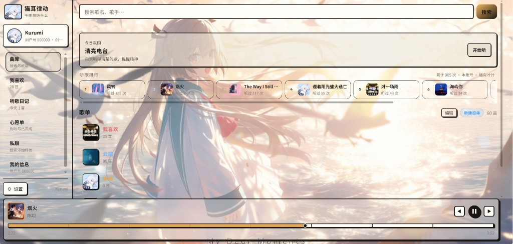
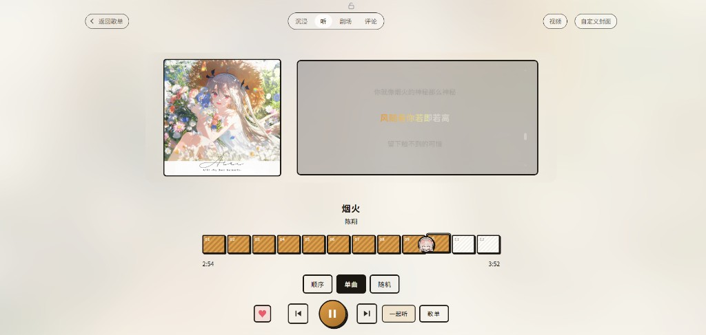
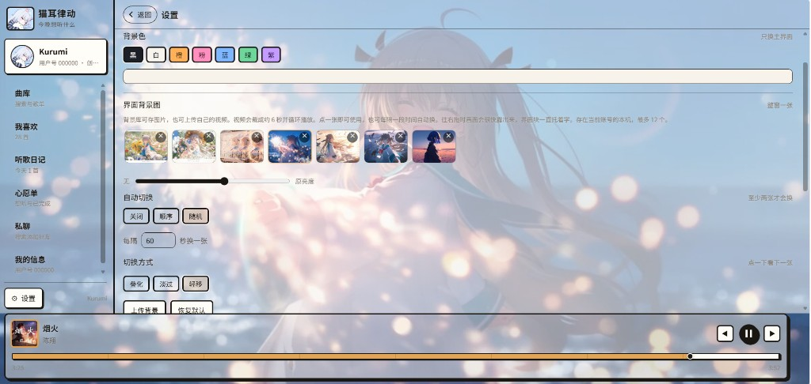
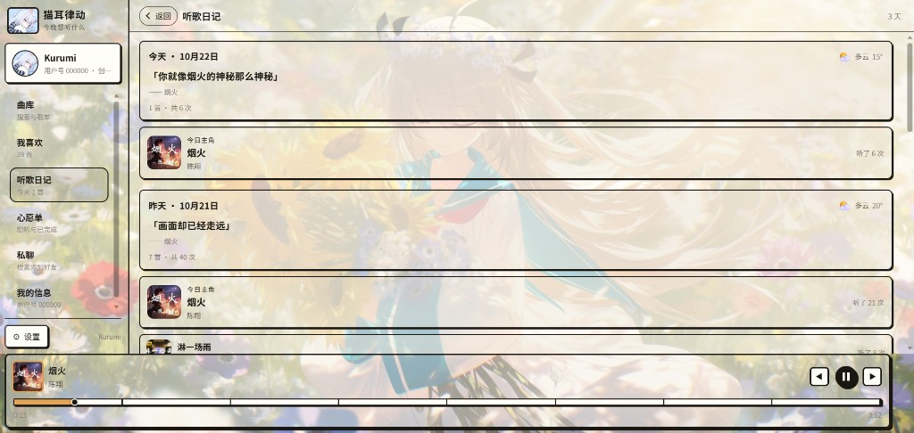

# 猫耳律动

本机桌面音乐播放器。当前版本 2.0.03。

## 功能

- 本地私人曲库播放歌词与视频
- 云端共同曲库评论好友与私信
- 剧场沉浸听歌与自定义封面
- 界面壁纸听歌日记与一起听
- Windows 安装包与便携版

## 网页版

打开即可使用登录与云端共同曲库：

https://catpassioner.github.io/ludong-player/

完整私人曲库与壁纸能力请用本机软件。

## 本机软件

发布页：

https://github.com/CatPassioner/ludong-player/releases

### 安装包

1. 下载 猫耳律动-安装包.exe
2. 双击安装并选择程序目录与歌曲目录
3. 需要 Windows 10 或 11以及 Edge 或 Chrome浏览器

### 便携版

1. 下载 猫耳律动-便携版.zip
2. 解压后双击 猫耳律动.exe

### 从源码运行

1. 安装 Python 3.10 及以上
2. 在项目根目录执行 `python desktop_app.py`
3. 也可执行 `python server.py` 后用浏览器打开提示地址

## 预览

剧场


主界面



听歌页



设置



听歌日记



## 源码与发版

仓库：

https://github.com/CatPassioner/ludong-player

打包命令：

```bash
python build_release.py
```

产物在 `release/` 目录不进入仓库。请勿上传无版权商业音乐到共同曲库。
